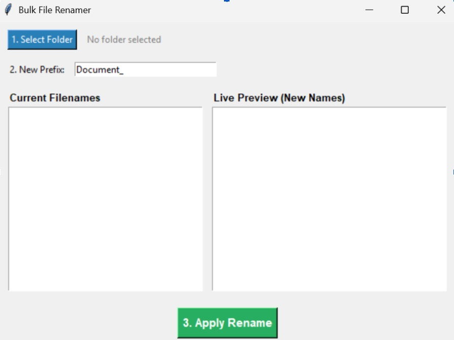

# Bulk File Renamer

## 1. Project Description

Bulk File Renamer is a simple desktop application developed using **Python and Tkinter** that allows users to rename multiple files simultaneously using a custom prefix and sequential numbering.

The application provides a live preview of the updated filenames before applying changes and preserves the original file extensions. It simplifies repetitive file-renaming tasks through an easy-to-use graphical user interface.

## 2. Features

- **Folder Selection:** Browse and select a folder containing the files to be renamed.
- **Custom Prefix:** Add a user-defined prefix to all selected filenames.
- **Sequential Numbering:** Automatically assign numbers in sequence (001, 002, 003, etc.).
- **Live Preview:** Display original and updated filenames side by side before renaming.
- **Extension Preservation:** Retain original file extensions such as `.pdf`, `.jpg`, `.docx`, etc.
- **Confirmation Before Renaming:** Display a confirmation dialog before applying changes.
- **Directory Filtering:** Exclude subdirectories and process files only.

## 3. Application Screenshots

### Main Application Interface



### Folder Selection


### Files Renamed Successfully


## 4. Real-World Application – College Professors

College professors and faculty members regularly handle large numbers of digital files, including student assignments, examination papers, project reports, lecture materials, and academic documents.

Managing these files with inconsistent filenames can become time-consuming.

Bulk File Renamer helps professors organize these files efficiently by assigning a common prefix and sequential numbers.

**Example:**

Original filenames:
- assignment_final.pdf
- submission_new.pdf
- document123.pdf

After renaming with the prefix `DSA_Assignment_`:

- DSA_Assignment_001.pdf
- DSA_Assignment_002.pdf
- DSA_Assignment_003.pdf

This provides a consistent naming structure, making academic files easier to identify, organize, and manage.

The application can also be useful for students, researchers, and administrative staff.

## 5. Technologies Used

- **Python:** Main programming language.
- **Tkinter:** Used to develop the graphical user interface.
- **OS Module:** Used for file and directory operations.

## 6. How to Run

### Prerequisites

- Python 3.x installed on your system.
- Tkinter (included with most standard desktop Python installations).

### Installation Steps

**Step 1: Clone the repository**

```bash
git clone https://github.com/dj873279-collab/Bulk-File-Renamer-.git
```

**Step 2: Navigate to the project directory**

```bash
cd Bulk-File-Renamer-
```

**Step 3: Run the application**

```bash
python bulk_renamer.py
```

The application window will open, allowing you to select a folder and begin renaming files.

## 7. Project Objective

The objective of this project is to develop a simple and efficient desktop application that automates repetitive file-renaming tasks.

It demonstrates the practical application of Python programming, graphical user interface development using Tkinter, and file-handling operations to solve a common file-management problem.

The objective of this project is to develop a simple, user-friendly desktop application that automates repetitive file-renaming tasks while demonstrating the practical use of Python programming, GUI development, and file-handling operations.
